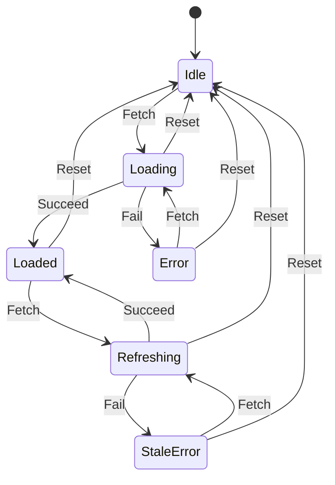

# State Machines (instead of flags)

You know state machines and the idiomatic encoding in each language (discriminated unions, enums with associated values, `match`). This skill fixes the procedure and the rules to hold.

## When to use

- 3+ booleans describing one lifecycle, or a `status` string any caller can set.
- Impossible-but-reachable combinations, "stuck in submitting forever".
- Flag flips in many callers; nobody can list every place state changes.
- The same `if (!isLoading && !isError && hasData)` guard repeated everywhere.
- An ordered workflow (`draft → submitted → reviewed → published`) enforced by boolean guards.

Skip for a single on/off flag, orthogonal toggles (`isFavorite`, `isPinned`), and throwaway scripts. Pairs with `adt-types`, which hides the state field so nothing bypasses the transition function; `focused-refactor` sequences both.

## Method

1. **List every flag and status field** on the entity, one line of meaning each. Do not filter yet.
2. **Enumerate the combinations.** Table all 2^N, mark each intended, illegal, or a design question. The illegal rows are the bugs the flags hid. Decide the questions explicitly with the user. Skip this table when only 2 flags collapse.
3. **Name states and events.** Events are external intentions (`Fetch`, `Succeed`, `Fail`, `Reset`), not implementation steps.
4. **Fill the transition table.** Every reachable state gets a row; every (state, event) cell gets a next state or stays empty, meaning rejected. A row you cannot fill means the design is not done.
5. **Encode.** One `state` field, one pure `transition(state, event)` returning the next state (plus effects to run, if any). Use the language's native enum/union; reach for a statechart library only for hierarchy or parallel regions.
6. **Migrate callers** from flag flips to `dispatch(event)` and from flag guards to matching on state. Delete the flags.

Example, every reachable state with a row:

| from \ event | Fetch      | Succeed | Fail       | Reset |
|--------------|------------|---------|------------|-------|
| Idle         | Loading    | —       | —          | —     |
| Loading      | —          | Loaded  | Error      | Idle  |
| Loaded       | Refreshing | —       | —          | Idle  |
| Refreshing   | —          | Loaded  | StaleError | Idle  |
| Error        | Loading    | —       | —          | Idle  |
| StaleError   | Refreshing | —       | —          | Idle  |

## Rules

- **Only `transition` changes state.** No other code writes the field.
- **Illegal events are rejected, not ignored.** Return an error, throw, or return the unchanged state with a logged warning — pick one per codebase and keep it. Silent no-ops hide bugs.
- **Transitions are pure.** Side effects are returned as data and run outside, so the machine can be tested and replayed.
- **Model terminal states** (`Cancelled`, `Completed`) and reject every event out of them.
- **One machine per concern.** 14 states that partition (payment vs shipping) are two machines composed.

## Output format

1. **Current flags** — the booleans/strings being replaced.
2. **Combination table** — intended combinations named, illegal ones called out.
3. **Transition table or `stateDiagram-v2`** — whichever is clearer; every reachable state appears.
4. **Code skeleton** — state type and `transition` in the user's language.
5. **Migration notes** — the top 3 flag-flipping call sites rewritten to dispatch events.

## Anti-patterns to refuse

- **String state without a transition function** — a state machine in name only.
- **Accepting every event in every state** — renamed booleans. The rejections are the point.
- **Statechart library for 4 states.**

## Quick mode

For ≤4 states: named states, a `stateDiagram-v2`, and the enum plus `transition` function.
